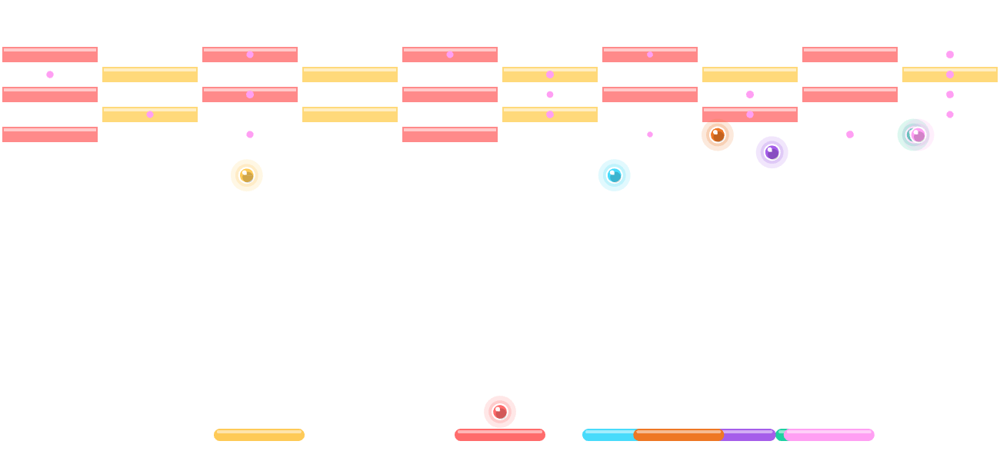
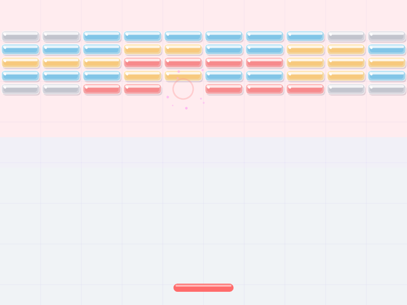
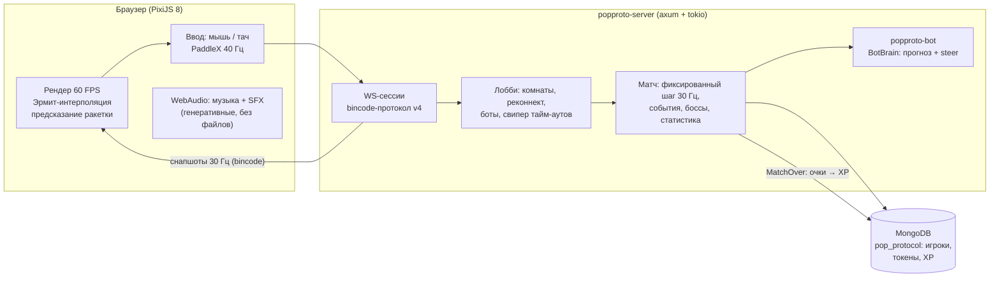

# PoP - Protocol

**Многопользовательский мультиплеерный арканоид на Rust** — кооперативный ремейк классического «поп-блоков»: до 10 игроков в комнате, серверная физика 30 Гц, боты трёх уровней с прогнозом траектории, 9 живых событий, 3 босса, режимы «Кооп / Босс-раш / Волна», XP и глобальный лидерборд.

| Gameplay | Финальная стена |
| --- | --- |
|  |  |

## Возможности

- **Лобби на 10 игроков** — комнаты с кодами и паролями, ready-check, хост, кик, зрители (с переходом в игроки), реконнект по токену с окном 90 с и АФК-ботом.
- **Серверная физика 30 Гц** — фиксированный шаг, пулы объектов, сетка коллизий; клиент рисует 60 FPS с кубической интерполяцией Эрмита и предсказанием своей ракетки.
- **Боты 3 уровней** — «Лентяй / Обычный / Профи»: реакция от 9 тиков до 1, шум прицела, прогноз точки падения с отражениями от стен и *управление отскоком* — профи смещает точку встречи, чтобы направить мяч в плотные кирпичи, и запускает мяч в сторону кластера.
- **9 событий** — метеоритный дождь, тьма, инверсия, золото ×3, ярость скорости, камнепад, капсульный фонтан, двойной мяч, щит земли.
- **3 босса** — Кракен (щупальца-щиты), Ледяной Голет (замораживающие снаряды), Мега-Кубик (ярость при 30 % HP). HP масштабируется числом живых игроков.
- **15 рукотворных уровней** с финальной бронированной стеной; процедурный генератор строк питает режим «Волна».
- **Мета** — XP за матчи (MongoDB), уровни игроков, глобальный топ `/api/leaderboard`, палитра цветов, ачивки матча (👑 MVP, 🎯 серия, 🧱 клейщик, 🐙 охотник на боссов).
- **Клиент-сайд джус** — стеклянные кирпичи с трещинами, параллакс-фон, шлейфы мячей, кольца взрывов, комбо-фейерверк, генеративная музыка и полный SFX-синтез через WebAudio (без единого аудиофайла), авто-деградация эффектов при FPS < 45, RU/EN локализация, мобильная вёрстка.

## Архитектура



**Поток матча:** клиент шлёт `PaddleX` (и события) → сервер исполняет фиксированные тики 30 Гц → рассылает бинарные снапшоты (дельта кирпичей + полный ресинк раз в 3 с) → клиент интерполирует Эрмитом между снапшотами вокруг `now − 1.6·Δt` и рисует.

**Крейты:**

| Крейт | Назначение |
| --- | --- |
| `popproto-core` | Протокол (bincode, v4), поле/физика, 15 уровней, генератор волн |
| `popproto-server` | axum-сервер: WS, лобби, игровой цикл, боссы, хранилище (MongoDB/память) |
| `popproto-bot` | ИИ ракеток: BotBrain с прогнозом падения и steer-отскоком |

## Запуск

Нужен Rust 1.7x и MongoDB (или собрать с хранилищем в памяти):

```bash
git clone https://github.com/LeviTankTV/PoPProtocol.git
cd PoPProtocol
cargo run -p popproto-server        # http://127.0.0.1:8080
```

Переменные окружения: `PORT` (8080), `MONGO_URL` (`mongodb://localhost:27017`), `RUST_LOG`.

Отладочные: `EVENT_TIMER_SECS` — фиксированный интервал событий; `POPGO_START_LEVEL` — стартовый уровень (15 — финальная стена, 3 — босс).

Через Docker:

```bash
docker compose up -d --build        # сервер на :8080 + MongoDB с volume
```

## Тесты и CI

82 юнит-теста: физика, лобби/реконнект/боты, 9 событий, 3 босса, режимы, XP/лидерборд, генератор, протокол. Плюс E2E-скрипты WebSocket-сессий (`tools/ws-smoke.mjs`, `tools/xp-e2e.mjs`).

```bash
cargo test --workspace              # 82 теста
cargo clippy --workspace --all-targets -- -D warnings
cargo fmt --check
```

GitHub Actions гоняет то же самое на каждый push (`.github/workflows/ci.yml`) плюс сборку Docker-образа.

## Протокол (кратко)

WebSocket + bincode little-endian, фиксированная ширина полей. `ClientMsg`: Hello(token) → JoinRoom/CreateRoom → PaddleX/Action → Chat/Emote → AddBot/SetColor. `ServerMsg`: Welcome(token) → RoomList/RoomState → MatchStarted → **Snapshot 30 Гц** (мячи, дельта кирпичей, капсулы, босс, события, комбо) → LevelCleared/MatchOver(статистика). Реконнект: обрыв держит слот 90 с, возврат по токену без пароля.

## Деплой

`Dockerfile` (multi-stage, healthcheck `/health`) + `docker-compose.yml` (сервер + mongo:7 с volume). Инструкция по VPS с TLS-прокси — в [`deploy/README.md`](deploy/README.md).

## Лицензия

MIT — см. [LICENSE](LICENSE).
